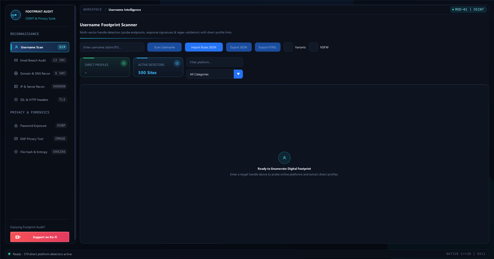

# 🛡️ Footprint Audit

**Native C++20 / DirectX 11 / Dear ImGui OSINT, Digital Footprint & Offline Forensics Suite for Windows x64**

[](https://github.com/drjhn291/footprint-audit/actions/workflows/build-windows.yml)
[](https://github.com/drjhn291/footprint-audit/releases/latest)
[](https://github.com/drjhn291/footprint-audit/releases)


[](LICENSE)
[](https://ko-fi.com/drjhn291)

---



## Overview

**Footprint Audit** is a lightweight, portable desktop suite engineered in pure **C++20** with hardware-accelerated **DirectX 11** rendering and **Dear ImGui**. Designed for security researchers, OSINT analysts, and privacy-conscious users, it combines multi-threaded online reconnaissance with local, privacy-preserving forensic tools in a single standalone binary—requiring **zero external runtimes** (no Python, Node.js, or Electron overhead).

---

## ✨ Modules & Features

### 🔎 Reconnaissance (`MOD-01` – `MOD-05`)
* **Username Scan (`519`):** Multi-threaded handle enumeration across **519 direct platform detectors** (`500` standard sites + optional `NSFW` toggle via `data/platforms.json`), username permutation generator (`Variants`), custom JSON rule imports (`Import Rules JSON`), category filtering, and one-click **JSON / HTML** report export.
* **Email Breach Audit (`12 SRC`):** Queries **12 breach & OSINT intelligence sources** and validates target domain **SPF** and **DMARC** email authentication records.
* **Domain & DNS Recon (`5 SRC`):** Enumerates `A`, `AAAA`, `MX`, `NS`, `TXT`, and `CNAME` DNS records alongside passive subdomain discovery.
* **IP & Server Recon (`SHODAN`):** Performs IP geolocation, ASN/ISP ownership lookups, open port enumeration, and exposed service fingerprinting.
* **SSL & HTTP Headers (`TLS`):** Inspects TLS/SSL certificate chains, issuer/expiration validity, and HTTP security response headers.

### 🔐 Privacy & Forensics (`MOD-06` – `MOD-08`)
* **Password Exposure (`HIBP`):** Audits password leaks using **SHA-1 k-Anonymity**—passwords are hashed locally and plain-text credentials never leave your device.
* **EXIF Privacy Tool (`IMAGE`):** Reads embedded camera metadata, timestamps, software tags, and GPS coordinates with a live DirectX 11 preview, and strips EXIF data into clean copies.
* **File Hash & Entropy (`SHA256`):** Computes offline `SHA-256`, `SHA-1`, and `MD5` digests (Windows CNG), Shannon entropy scores, and magic-byte file signatures, with **VirusTotal API v3** integration (instant hash lookups + large file uploads up to **650 MB**) and HTML antivirus breakdown reports.

---

## 📦 Quick Start (Portable Binary)

1. Download **`footprint-audit-win64.zip`** from the [**Latest Release**](https://github.com/drjhn291/footprint-audit/releases/latest).
2. Extract the archive into any folder, keeping `footprint-audit.exe`, `data/`, and `assets/` in the same directory.
3. Launch **`footprint-audit.exe`**.

### Optional: VirusTotal API v3 Setup
To enable cloud hash lookups and file scanning inside **File Hash & Entropy**:
1. Obtain a free or premium API key from [VirusTotal](https://www.virustotal.com/).
2. Paste the key directly inside the module's input field in the app.
3. Your key is stored locally at `%LOCALAPPDATA%\FootprintAudit\vt_apikey.txt` and is never included in the application folder or repository.

---

## 🛠️ Building from Source

### Prerequisites
* **OS:** Windows 10 / 11 (x64)
* **Compiler:** Visual Studio 2022 or newer (MSVC with C++20 support)
* **Build System:** CMake 3.20+ *(third-party dependencies such as Dear ImGui and nlohmann/json are fetched automatically during configuration)*

### Compile
```powershell
git clone https://github.com/drjhn291/footprint-audit.git
cd footprint-audit
cmake -B build
cmake --build build --config Release
```

The compiled executable will be generated at `build/Release/footprint-audit.exe`.

---

## 📁 Repository Structure

```text
footprint-audit/
├── .github/workflows/   # Automated CI builds & GitHub Release packaging
├── assets/              # Application icons, Win32 resources (.rc) & UI preview
├── data/                # Platform detection rules (platforms.json)
├── src/                 # C++20 core, OSINT engines, WinHTTP client & DX11/ImGui UI
├── CMakeLists.txt       # CMake build configuration
├── CMakeSettings.json   # Visual Studio CMake presets
├── .clang-format        # Code formatting rules
└── LICENSE              # MIT License
```

---

## ⚠️ Disclaimer

This software is intended strictly for **educational purposes, authorized security assessments, and personal digital footprint auditing**. Users are solely responsible for complying with applicable local laws and platform Terms of Service.

---

## 📄 License & Support

* **License:** Distributed under the [MIT License](LICENSE).
* **Support:** If you find **Footprint Audit** useful, consider supporting future updates on [Ko-fi](https://ko-fi.com/drjhn291).
